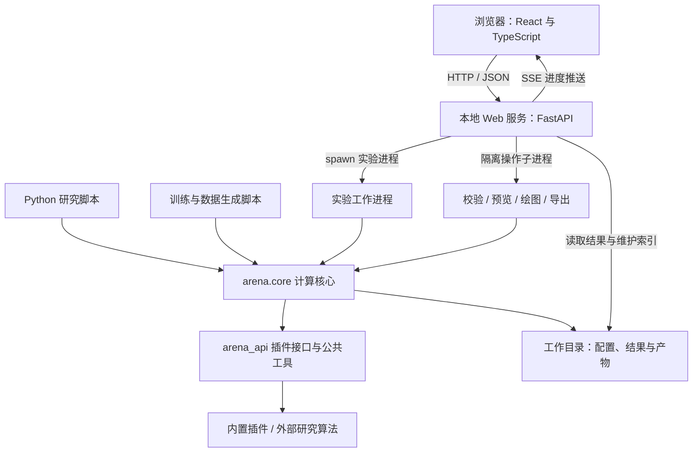

# DOA 算法竞技场：整体架构说明

更新日期：2026-11-21。本文是便于理解与交接的架构说明，依据当前代码和正式设计文档整理；不替代接口规范、数据格式规范，也不代表所有功能已完成验收。

## 1. 项目定位

本项目是一个本地运行、插件可扩展的 DOA 算法实验平台。

它为不同算法提供统一的信号生成、场景配置、阵列误差、实验执行、指标计算和结果展示机制，使研究者可以在相同条件下比较算法，并保存可追溯的实验记录。

网页用于交互配置、观察结果和导出；Python 接口用于批量实验与研究脚本；数据生成接口用于训练数据准备。这些入口共用计算核心，避免各自维护不同的信号模型。

项目的首要原则是忠实呈现已声明的算法实现及其成本。不能为了接近 CRB、改善曲线或排名，自动添加未声明的增强处理。

## 2. 总体分层

| 层次 | 主要职责 | 边界 |
|---|---|---|
| 前端 | 动态参数表单、草稿、交互、图表渲染、场景示意 | 不生成仿真信号，不计算估计结果、指标或 CRB |
| Web 服务 | 发布 Schema、资源管理、任务调度、进度推送、结果读取 | 不在服务进程中执行算法或加载 PyTorch |
| 计算核心 | 场景生成、实验执行、匹配、指标、CRB、存储、绘图和导出 | 不依赖 Web 服务，可供脚本直接调用 |
| 插件接口 | 定义输入输出、参数、能力与生命周期；提供公共数值工具 | `arena_api` 不依赖 `arena` |
| 文件与索引 | 保存实验事实和检索信息 | 结果文件可独立读取，索引用于辅助检索 |

## 3. 两个 Python 包

### `arena_api`：插件与平台之间的契约

位置：`packages/arena_api/src/arena_api/`。

定义算法、阵列、误差、指标等插件基类，观测与估计结果类型，参数声明、能力描述及公共工具。`arena_api.kit` 提供空间平滑、子空间、网格与寻峰等共享数值操作。

外部算法通过这个接口包接入，避免依赖平台内部的任务、存储和页面实现。内置算法也遵守同样的接口。

### `arena`：计算核心、应用服务与脚本入口

位置：`packages/arena/src/arena/`。

顶层导出 `Workspace`、`run`、`load_result`、`Scenario`、`algorithm`、`recompute_metrics` 等脚本接口。主要实现位于 `core/`；Web 服务位于 `server/`。

依赖方向为：前端调用服务，服务调度核心，核心调用插件接口。核心和接口包不反向依赖页面或服务。

## 4. 核心模块

| 位置（相对于 `arena/core/`） | 职责 |
|---|---|
| `config/` | Pydantic 配置模型、默认值、校验、扫描配置与历史配置兼容 |
| `arrays/`、`signals/`、`impairments/`、`scenario/` | 阵列、信源、噪声与误差模型，组装一次试验的数据 |
| `rng.py` | 按实验种子和派生路径管理随机数 |
| `algorithms/` | 内置算法基线及显式变体 |
| `runner/` | 单次、蒙特卡罗、参数扫描、并行、预热、进度与取消 |
| `metrics/`、`crb/` | 角度匹配、误差与成功率等指标、理论参考界 |
| `storage/` | 实验配置、状态、结果和追溯信息的持久化 |
| `figures/`、`export/`、`reports/` | 图表描述、图片和表格导出、报告生成 |
| 数据集、模型和基准相关模块 | 数据生成、模型包检查、标准场景集与评测 |
| `operations.py` | 为服务提供隔离进程中的校验、预览、绘图等操作入口 |

这里的“计算核心”包括核心调用的插件及接口包公共数值工具；它不要求把所有数值代码放进同一个文件或包目录。

## 5. 前端与 Schema 数据流

前端使用 React、TypeScript、Vite、Ant Design 和 Plotly。当前使用自建通用组件 `ConfigFields` 渲染 Schema，网络访问集中在 `frontend/src/services/api.ts`。

1. 后端从配置模型和插件参数模型生成 JSON Schema，并补充显示元数据。
2. 前端按 Schema 生成字段，不维护每种算法的专用参数清单。
3. 编辑结果存入实验草稿；预览、规范化和运行前校验通过相应接口完成。
4. 无效草稿保留原值和字段错误，允许继续编辑。
5. 提交实验后，通过 SSE 接收进度，通过结果接口读取图表和明细。

常用元数据包括：

- `x-label`、`x-help`：中文字段名称和说明。
- `x-enum-labels`、`x-enum-descriptions`：枚举选项的中文名称和解释。
- `x-visible-when`：字段的显示条件。
- `x-sweep`：允许扫描的参数、分类、建议范围和生效条件。

环境检测在服务启动后后台执行并缓存，可手动重新检测；新建实验页不需要每次等待完整环境探测。

场景示意图可在前端做坐标映射和范围着色，但真实场景数据来自核心预览。统一搜索范围只用于说明搜索区域，不改变真实信源方向。

## 6. 一次实验如何执行

1. 用户选择实验方式，配置场景、算法、指标及运行选项。
2. 配置模型完成校验与规范化，确定有效参数、扫描点和插件来源。
3. Web 任务管理器创建独立实验进程；当前实现使用 `multiprocessing` 的 `spawn` 模式。
4. 核心按派生种子生成每次试验数据，将同次试验的观测交给参与比较的算法。
5. 算法返回角度估计及可选空间谱；核心进行匹配、指标计算和聚合。
6. 配置、状态、结果及相关产物写入工作目录；服务读取状态并推送进度。
7. 前端显示结果；绘图、重算和导出继续复用核心能力。

耗时属于运行测量，不能要求跨入口、跨机器逐位一致。数值复现还需要考虑配置、随机种子、生成器与算法版本、依赖环境和计算设备等条件。

## 7. 进程隔离与文件存储

长时间实验运行在工作进程中；需要执行插件或数值逻辑的短操作通过 `arena.core.operations` 子进程入口处理。服务进程主要保持交互、调度和资源管理能力，避免被算法初始化和计算阻塞。

结果采用 JSON、NumPy 数组文件等公开格式，配置、汇总、状态、逐次估计及导出产物按数据规范保存。SQLite 提供检索索引，不替代实验文件本身。

关键约束：

- JSON 和 NPZ 采用临时文件写入后重命名，减少中断造成的损坏。
- 结果不使用 pickle，读取数组禁止对象反序列化。
- 记录配置、种子、插件及代码版本等追溯信息。
- 数据集、模型权重和实验产物不作为普通源码提交。
- Web 服务只监听 `127.0.0.1`。

## 8. 插件、模型与公平比较

插件可扩展算法、阵列、误差及指标。研究算法通过插件声明接入；学习型算法还需提供可检查的模型包及训练信息。PyTorch 按需加载，服务进程不直接加载它。

公平比较由以下规则共同保证：

- 统一场景、信号生成和评价口径。
- 明确信源数来源、预处理、失败处理和计时边界。
- 谱搜索基线默认使用统一固定网格，关闭峰值细化。
- 插值、局部加密和独立网格作为显式配置，不能自动启用以改善曲线。
- 历史实验保留原参数语义，不能因默认值改变而悄悄重解释。
- 载频仅用于物理间距显示；仿真使用波长归一化坐标。

平台验收通过不等于已经证明每个算法逐项忠实于原论文。论文忠实性仍需结合来源、公式、实现选择和测试证据审查。

## 9. 运行与开发

开发模式中，前端开发服务、后端服务和原型静态服务分别运行；`start_dev.ps1` 负责启动与重启，`start_prototype.ps1` 提供原型 HTTP 入口。构建后的前端静态文件也可由后端提供，正常运行不依赖 Vite 开发服务。

当前常用本机地址：

- 实际页面：`http://127.0.0.1:3000/`
- 后端：`http://127.0.0.1:8765/`
- 原型：`http://127.0.0.1:4173/index.html`

核心代码遵守 Python 3.10 兼容要求，便于 Linux 与云端使用。前端当前测试脚本使用 Node 内置测试运行器；后端使用 pytest，提交前使用 Ruff 和 pre-commit 等检查。

## 10. 与正式设计、验收状态的关系

本文按当前实现描述，避免把早期选型当成已安装组件。例如架构设计曾列出 react-jsonschema-form、TanStack Query、Vitest；当前前端实际使用自建 `ConfigFields`、Axios 和 Node 测试运行器。服务实验进程也应以现有 `tasks.py` 的 spawn 实现理解，不能仅按早期图示认定使用 CLI 子命令启动。

本说明不重新宣布 P0/P1 或 M1–M7 全部验收通过。真实 AutoDL、Edge 专项和 Word 报告的暂缓安排，以及浏览器视觉验收受阻等事项，应查看相应报告。

进一步阅读：

- `00_项目总览.md`：目标、设计原则和验收重点。
- `01_需求规格说明书.md`：需求与优先级。
- `02_系统架构设计.md`：正式架构约定。
- `03_算法接口规范.md`：插件契约和算法规格。
- `04_数据格式规范.md`：配置、结果与模型包格式。
- `05_产品原型.md`、`prototype/index.html`：界面与交互。
- `milestones/`：测试结果、偏离、已知问题及验收记录。

规范冲突按项目约定以 03 → 04 → 02 → 01 的顺序处理。本文仅帮助理解，不覆盖上述规范。
